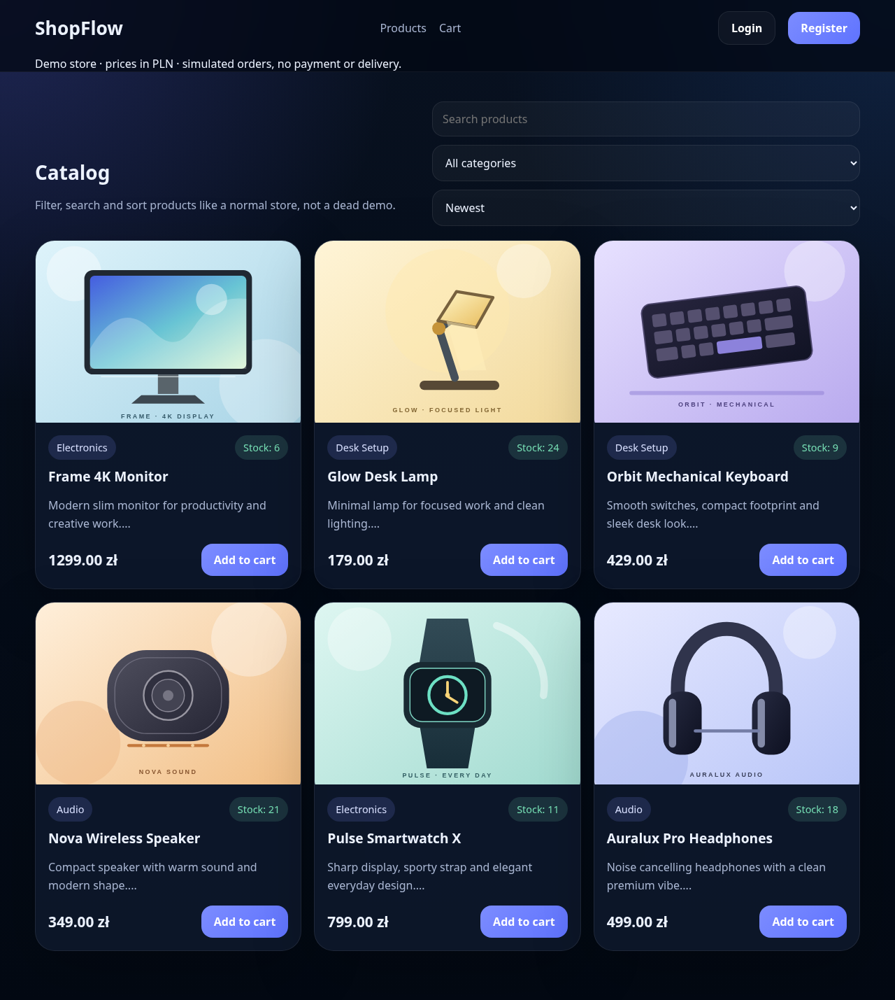
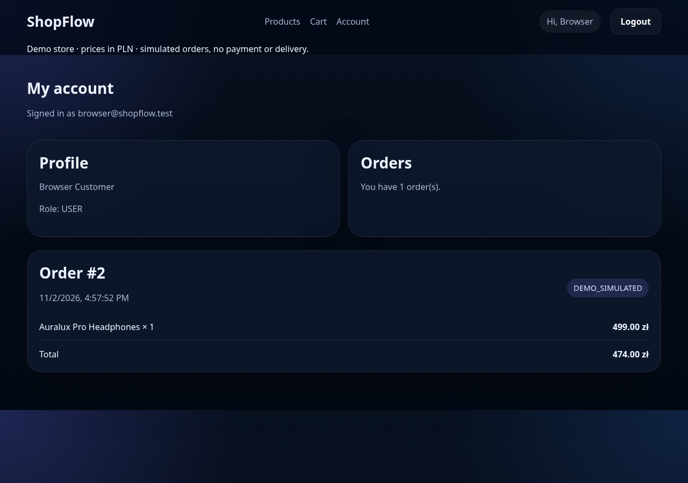

# ShopFlow

ShopFlow is a local e-commerce demo that takes a customer from the product catalog through a coupon checkout to a saved order. It includes registration, sign-in, role checks, inventory reservation, order history and an admin page. The catalog uses original local SVG illustrations, so the demo does not depend on an image host.





## Run locally

Requirements: Node.js 24.15 or newer within the Node.js 24 line, matching CI and both package engines.

### 1. Start the API

```bash
cd server
cp .env.example .env
```

Set a private `JWT_SECRET` in `server/.env`. Generate one with:

```bash
node -e "console.log(require('crypto').randomBytes(48).toString('base64url'))"
```

Then install the server, generate Prisma Client, create the SQLite file, apply the migrations and load the demo records:

```bash
npm ci
npx prisma generate
node -e "require('fs').closeSync(require('fs').openSync('prisma/dev.db', 'a'))"
npx prisma migrate deploy
npm run seed
npm run dev
```

The API runs at `http://127.0.0.1:3000`. The seed is for a fresh local database; it refuses to run if users, products or orders already exist. It provides a local admin account (`admin@shopflow.com` / `Admin123!`) and the `WELCOME10` coupon. These are demo credentials for a private local database only.

### 2. Start the frontend

In another terminal:

```bash
cd client
cp .env.example .env
npm ci
npm run dev
```

Open `http://localhost:5173`. Register a customer, add Auralux Pro Headphones to the cart, check `WELCOME10`, enter a demo address and place the order. The account page keeps the order after reload.

## What the demo does

- Authenticates customers and separates user and admin routes
- Searches, filters and sorts the seeded catalog
- Validates coupons and shipping fields
- Reserves stock atomically inside the order transaction
- Saves order totals and item prices in integer grosz
- Keeps cart data in a versioned, validated local-storage format; also reads historical arrays without writing on mount
- Displays all orders as `DEMO_SIMULATED`; the checkout does not charge money or arrange delivery

The API returns prices as PLN decimal values for the UI, but stores them as integer grosz. Fixed coupon amounts use grosz; percentage coupons use basis points. The `202610280001_exact_demo_money` migration converts earlier floating-point values with two-decimal rounding and changes prior simulated `PAID` labels to `DEMO_SIMULATED`.

Orders are limited to a subtotal of 21,474,836.47 PLN before discounts; larger requests return a validation error without reserving stock. Each line is limited to 10,000 units and product prices to 1,000,000 PLN.

Before applying migrations to an existing database, make a copy. Never use `prisma migrate reset` on a database with records you need. The tests create their own temporary SQLite databases. They cover fresh installation and a populated historical schema, preserving records and relations while converting money, then applying migrations again without changes. An existing database created by `db push` requires schema comparison and deliberate Prisma baselining; do not mark an unknown schema as already migrated.

## Browser storage and sessions

If a cart is malformed or storage is unavailable, the app explains that it is working only in the current tab. It preserves the original `shopflow_cart` value and does not automatically replace it with an empty or partially filtered cart. Edits in this mode are not saved and disappear on reload; the original remains available for recovery. Valid edits write the current version 1 format and calculate totals in integer grosz.

Sign-in can work in memory when persistence fails. Requests use the active tab's token, so a failed logout cannot silently reuse an older stored token. If removal fails, the app explicitly warns that the saved sign-in may return after reload; clear the site's browser data before sharing the device. Late responses and sign-in changes in another tab cannot restore a session that was ended locally.

Temporary failures checking the session preserve the token and show **Retry session**. Rejected, deleted or invalid account responses end the session. Browser token storage remains unencrypted and accessible to page JavaScript; this demo does not claim a production cookie-based session design.

## Checks

```bash
cd server
npm test
npm run typecheck
npm run build
npm audit --audit-level=low
cd ../client
npm test
npm run typecheck
npm run build
npm audit --audit-level=low
```

The backend has 58 tests for authentication, roles, request parsing, limits, coupons, integer money, concurrency and populated-database migration. The 41 frontend tests use real React providers and Axios with controlled storage/HTTP adapters; they are component tests, not a substitute for API integration. Three sandboxed Chromium scenarios exercise the real API and temporary SQLite: checkout/order reload/accessibility, corrupt-cart preservation and legacy migration, and session-network recovery plus failed persistent logout. They refresh screenshots under `docs/screenshots/`:

```bash
cd client
VITE_API_URL=http://127.0.0.1:18311/api npm run build
cd ..
python -m pip install -r e2e/requirements.txt
python -m playwright install chromium
PLAYWRIGHT_CHROMIUM_EXECUTABLE_PATH=/path/to/chromium python -m pytest -q e2e
```

See [dated recovery evidence and prior PR dispositions](docs/RECOVERY_VALIDATION.md). The dependency gate rejects all reported severities.

## Boundaries

This is a portfolio demo, not a live store. It has no payment processor, shipping integration, production-grade session cookies or multi-instance database. The API defaults to loopback and requires a private JWT secret. The demo admin password is intentionally public; do not reuse it outside the local demo.

## License

MIT. See [LICENSE](LICENSE).
