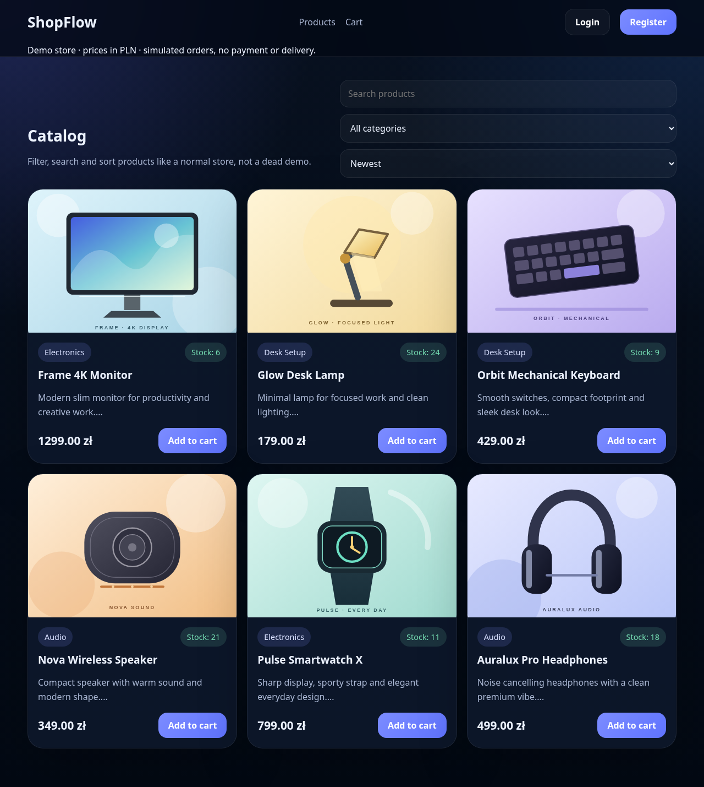
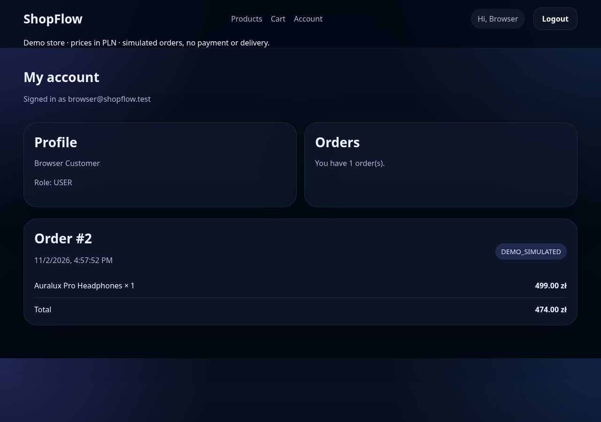

# ShopFlow

ShopFlow is a local e-commerce demo that takes a customer from the product catalog through a coupon checkout to a saved order. It includes registration, sign-in, role checks, inventory reservation, order history and an admin page. The catalog uses original local SVG illustrations, so the demo does not depend on an image host.





## Run locally

Requirements: Node.js 20 or newer.

### 1. Start the API

```bash
cd server
cp .env.example .env
```

Set a private `JWT_SECRET` in `server/.env`. Generate one with:

```bash
node -e "console.log(require('crypto').randomBytes(48).toString('base64url'))"
```

Then install the server, generate Prisma Client, create the SQLite file, apply the migrations and load the demo records:

```bash
npm ci
npx prisma generate
node -e "require('fs').closeSync(require('fs').openSync('prisma/dev.db', 'a'))"
npx prisma migrate deploy
npm run seed
npm run dev
```

The API runs at `http://127.0.0.1:3000`. The seed is for a fresh local database; it refuses to run if users, products or orders already exist. It provides a local admin account (`admin@shopflow.com` / `Admin123!`) and the `WELCOME10` coupon. These are demo credentials for a private local database only.

### 2. Start the frontend

In another terminal:

```bash
cd client
cp .env.example .env
npm ci
npm run dev
```

Open `http://localhost:5173`. Register a customer, add Auralux Pro Headphones to the cart, check `WELCOME10`, enter a demo address and place the order. The account page keeps the order after reload.

## What the demo does

- Authenticates customers and separates user and admin routes
- Searches, filters and sorts the seeded catalog
- Validates coupons and shipping fields
- Reserves stock atomically inside the order transaction
- Saves order totals and item prices in integer grosz
- Keeps cart data in a versioned, validated local-storage format
- Displays all orders as `DEMO_SIMULATED`; the checkout does not charge money or arrange delivery

The API returns prices as PLN decimal values for the UI, but stores them as integer grosz. Fixed coupon amounts use grosz; percentage coupons use basis points. The `202610280001_exact_demo_money` migration converts earlier floating-point values with two-decimal rounding and changes prior simulated `PAID` labels to `DEMO_SIMULATED`.

Before applying migrations to an existing database, make a copy. Never use `prisma migrate reset` on a database with records you need. The tests create their own temporary SQLite database and apply the migrations there.

## Checks

```bash
cd server
npm test
npm run typecheck
npm run build
cd ../client
npm run typecheck
npm run build
```

The server suite has 37 tests for authentication, roles, validation, rate limits, coupons, exact totals, concurrency and error handling. A Playwright scenario covers the catalog, real fixed-coupon checkout, saved order after reload and accessibility. It uses a temporary database and refreshes the screenshots under `docs/screenshots/`:

```bash
cd client
VITE_API_URL=http://127.0.0.1:18311/api npm run build
cd ..
python -m pip install -r e2e/requirements.txt
PLAYWRIGHT_CHROMIUM_EXECUTABLE_PATH=/path/to/chromium python -m pytest -q e2e
```

## Boundaries

This is a portfolio demo, not a live store. It has no payment processor, shipping integration, production-grade session cookies or multi-instance database. The API defaults to loopback and requires a private JWT secret. The demo admin password is intentionally public; do not reuse it outside the local demo.

## License

MIT. See [LICENSE](LICENSE).
